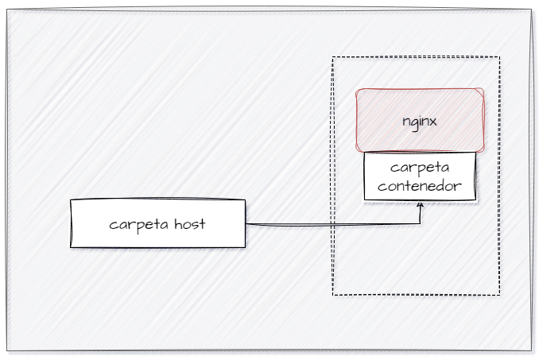

# BIND MOUNT
En un bind mount mapeamos (montar) un directorio o archivo específico del sistema de archivos del host con una parte del sistema de ficheros del contenedor.

```
docker run -d --name <nombre contenedor> -v <ruta carpeta host>:<ruta carpeta contenedor> <imagen> 
```
ó
```
docker run -d --name <nombre contenedor> --mount type=bind,source=<ruta carpeta host>,target=<ruta carpeta contenedor> <imagen>
```
- destination, dst, target: La ruta donde se monta el archivo o directorio en el contenedor.
- source, src: El origen del montaje.
  
### En tu computador crear una carpeta llamada nginx y dentro de esta carpeta crea otra llamada html. Como se aprecia en la figura.


### Crear un contenedor con la imagen nginx:alpine, mapear todos por puertos, para la ruta carpeta host colocar el directorio en donde se encuentra la carpeta html en tu computador y para la ruta carpeta contenedor: /usr/share/nginx/html (esta ruta se obtiene al revisar la documentación de la imagen)

# COMPLETAR CON EL COMANDO
docker run -d --name servPractica1 -p 8080:80 -v C:\Users\P3E010-D\Downloads\nginx\html:/usr/share/nginx/html nginx:alpine

### ¿Qué sucede al ingresar al servidor de nginx?
Al ingresar al servidor de nginx nos econtramos con la página web que nos da error 403

# COMPLETAR CON LA RESPUESTA A LA PREGUNTA

### ¿Qué pasa con el archivo index.html del contenedor?
El archivo index.html se muestra dentro del contenedor 
# COMPLETAR CON LA RESPUESTA A LA PREGUNTA

### Ir a https://html5up.net/ y descargar un template gratuito, descomprirlo dentro de tu computador en la carpeta html
### ¿Qué sucede al ingresar al servidor de nginx?
# COMPLETAR CON LA RESPUESTA A LA PREGUNTA

### Eliminar el contenedor
docker rm servPractica1
# COMPLETAR CON EL COMANDO
docker run -d --name servPractica1 -p 8080:80 -v C:\Users\P3E010-D\Downloads\nginx\html:/usr/share/nginx/html nginx:alpine

### ¿Qué sucede al crear nuevamente un contenedor montado al directorio definidos anteriormente?
Una vez eliminado eliminado el contenedor en la página web nos da error o que no se puede acceder a la página y al crear un nuevo contenedor montando al directorio definido anteriormente, la  página se vuelve a mostrar con el index.html gracias al volumen que se puso
# COMPLETAR CON LA RESPUESTA A LA PREGUNTA


