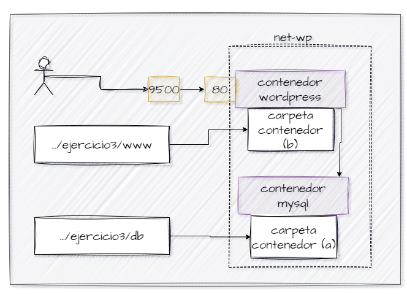

## Esquema para el ejercicio

### Crear red net-wp
docker network create net-wp

# COMPLETAR CON EL COMANDO COMANDO

### Para que persista la información es necesario conocer en dónde mysql almacena la información.
# COMPLETAR LA SIGUIENTE ORACIÓN. REVISAR LA DOCUMENTACIÓN DE LA IMAGEN EN https://hub.docker.com/
En el esquema del ejercicio carpeta del contenedor (a) es var/lib/mysql.

Ruta carpeta host: .../ejercicio3/db

### ¿Qué contiene la carpeta db del host?
La carpeta `db` del host contiene los archivos de datos que MySQL utiliza para almacenar y administrar las bases de datos. Inicialmente se encontraba vacía, pero al ejecutar el contenedor y realizar la inicialización de MySQL, se crean archivos y directorios necesarios para su funcionamiento.

# COMPLETAR CON LA RESPUESTA A LA PREGUNTA

### Crear un contenedor con la imagen mysql:8  en la red net-wp, configurar las variables de entorno: MYSQL_ROOT_PASSWORD, MYSQL_DATABASE, MYSQL_USER y MYSQL_PASSWORD
docker run -d --name mysql-wp --network net-wp -v "C:\Users\marle\OneDrive\Documentos\Construccion y evolucion\ejercicio3\db:/var/lib/mysql" -e MYSQL_ROOT_PASSWORD=ada123 -e MYSQL_DATABASE=wordpress -e MYSQL_USER=wpuser -e MYSQL_PASSWORD=ada123 mysql:8
# COMPLETAR CON EL COMANDO

### ¿Qué observa en la carpeta db que se encontraba inicialmente vacía?
Se observa que la carpeta `db`, que inicialmente estaba vacía, comienza a contener archivos y directorios relacionados con el almacenamiento y funcionamiento de MySQL. Esto ocurre porque la carpeta del host está vinculada con `/var/lib/mysql` mediante un bind mount. Por lo tanto, los datos se almacenan directamente en el computador y no únicamente dentro del contenedor.
# COMPLETAR CON LA RESPUESTA A LA PREGUNTA

### Para que persista la información es necesario conocer en dónde wordpress almacena la información.
# COMPLETAR LA SIGUIENTE ORACIÓN. REVISAR LA DOCUMENTACIÓN DE LA IMAGEN EN https://hub.docker.com/
En el esquema del ejercicio la carpeta del contenedor (b) eses /var/www/html.

Ruta carpeta host: .../ejercicio3/www

### Crear un contenedor con la imagen wordpress en la red net-wp, configurar las variables de entorno WORDPRESS_DB_HOST, WORDPRESS_DB_USER, WORDPRESS_DB_PASSWORD y WORDPRESS_DB_NAME (los valores de estas variables corresponden a los del contenedor creado previamente)
docker run -d --name wordpress-wp --network net-wp -p 9500:80 -v "C:\Users\marle\OneDrive\Documentos\Construccion y evolucion\ejercicio3\www:/var/www/html" -e WORDPRESS_DB_HOST=mysql-wp:3306 -e WORDPRESS_DB_USER=wpuser -e WORDPRESS_DB_PASSWORD=ada123 -e WORDPRESS_DB_NAME=wordpress wordpress
# COMPLETAR CON EL COMANDO

### Personalizar la apariencia de wordpress y agregar una entrada

### Eliminar el contenedor y crearlo nuevamente, ¿qué ha sucedido?
Al eliminar el contenedor WordPress y crearlo nuevamente utilizando el mismo bind mount, los archivos almacenados en la carpeta `www` del host permanecen disponibles. Además, como la base de datos MySQL se encuentra almacenada en la carpeta `db` del host, las entradas publicadas, la configuración del sitio y otra información guardada en la base de datos pueden mantenerse. Por esta razón, al acceder nuevamente a WordPress, se espera que el sitio conserve su personalización y las entradas creadas. Esto demuestra que los bind mounts permiten mantener los archivos y los datos fuera de los contenedores, independientemente de su eliminación o recreación.

# COMPLETAR CON LA RESPUESTA A LA PREGUNTA 

